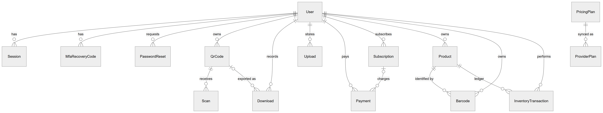

# QRSathi — Database Design

Derived from `prisma/schema.prisma` (canonical, SQLite provider) and `prisma/mysql/schema.prisma` (generated MySQL schema) with the migrations in `prisma/mysql/migrations/`. No database contents were read.

## 1. Overview

- **ORM:** Prisma 6.19.3. **Databases:** SQLite (development, `prisma db push`), MySQL 8 (production target, `prisma migrate deploy` with two migrations: `20261025000000_init`, `20261025180000_billing_branding`).
- **22 models.** 15 are connected by foreign keys; 7 are standalone.
- **Keys:** CUID string primary keys (except `PricingPlan.id`, `Setting.key`, `RateLimit.key`).
- **Tenancy:** almost all business rows carry `userId` and cascade on user deletion.
- **Money:** integer minor units (paise). **JSON:** stored as text and validated by zod in the application.

## 2. Diagrams

| Figure | File |
|---|---|
| Conceptual model | `diagrams/conceptual-model.mmd` → `diagrams/rendered/conceptual-model.png` |
| ER overview | `diagrams/database-erd.mmd` |
| Accounts, sessions, QR and analytics | `diagrams/erd-accounts-qr.mmd` |
| Products, barcodes and inventory | `diagrams/erd-inventory.mmd` |
| Pricing, subscriptions and payments | `diagrams/erd-billing.mmd` |

## 3. Model summary

| Model | Scalar columns | Unique constraints | Secondary indexes | Foreign keys to |
|---|---|---|---|---|
| User | 17 | 2 | 0 | — |
| PasswordReset | 6 | 1 | 0 | User |
| QrCode | 20 | 1 | 1 | User |
| Scan | 9 | 0 | 1 | QrCode |
| Download | 6 | 0 | 1 | User, QrCode |
| Upload | 7 | 1 | 0 | User |
| AbuseReport | 8 | 0 | 0 | — |
| Payment | 16 | 1 | 2 | User, Subscription |
| PricingPlan | 13 | 0 | 0 | — |
| ProviderPlan | 9 | 1 | 1 | PricingPlan |
| Subscription | 16 | 1 | 1 | User |
| WebhookEvent | 7 | 1 | 1 | — |
| BrandAsset | 9 | 1 | 1 | — |
| Log | 6 | 0 | 1 | — |
| Setting | 2 | 0 | 0 | — |
| Product | 20 | 1 | 2 | User |
| Barcode | 9 | 1 | 2 | User, Product |
| InventoryTransaction | 9 | 0 | 2 | User, Product |
| Session | 9 | 0 | 2 | User |
| MfaRecoveryCode | 5 | 1 | 1 | User |
| AuditLog | 9 | 0 | 3 | — |
| RateLimit | 3 | 0 | 1 | — |

## 4. Relationships

| Parent | Child | Cardinality | FK | On delete |
|---|---|---|---|---|
| User | Session, MfaRecoveryCode, PasswordReset | 1:N | `userId` | Cascade |
| User | QrCode, Download, Upload | 1:N | `userId` | Cascade |
| User | Product, Barcode, InventoryTransaction | 1:N | `userId` | Cascade |
| User | Subscription, Payment | 1:N | `userId` | Cascade |
| QrCode | Scan | 1:N | `qrId` | Cascade |
| QrCode | Download | 0..1:N | `qrId` (nullable) | SetNull |
| Product | Barcode, InventoryTransaction | 1:N | `productId` | Cascade |
| Subscription | Payment | 0..1:N | `subscriptionId` (nullable) | SetNull |
| PricingPlan | ProviderPlan | 1:N | `planId` | Restrict |

Standalone: AbuseReport, WebhookEvent, BrandAsset, Log, Setting, AuditLog, RateLimit (they must outlive users or are global).

## 5. Constraints and indexes

| Model | Constraint / index | Purpose |
|---|---|---|
| User | `email` UNIQUE, `googleId` UNIQUE | Identity |
| QrCode | `shortCode` UNIQUE; `@@index([userId])` | Global short-link namespace; list per user |
| Scan | `@@index([qrId, createdAt])` | Analytics by time |
| Product | `@@unique([userId, sku])`; `@@index([userId, status])`; `@@index([userId, category])` | Per-user SKU; filtered lists |
| Barcode | `@@unique([userId, format, value])`; `@@index([userId, lookupKey])`; `@@index([productId])` | Per-user barcode uniqueness; scan lookup |
| InventoryTransaction | `@@index([productId, createdAt])`; `@@index([userId, createdAt])` | Ledger reads |
| Payment | `providerRef` UNIQUE; `@@index([userId, createdAt])`; `@@index([subscriptionId])` | Idempotency |
| Subscription | `providerSubscriptionId` UNIQUE; `@@index([userId, status])` | Provider mapping; live subscription lookup |
| ProviderPlan | `providerPlanId` UNIQUE; `@@index([planId, interval, mode, active])` | Checkout lookup |
| WebhookEvent | `@@unique([provider, eventId])`; `@@index([receivedAt])` | Duplicate delivery detection |
| Session | `@@index([userId])`; `@@index([expiresAt])` | Revocation; clean-up |
| MfaRecoveryCode | `codeHash` UNIQUE; `@@index([userId])` | One-time codes |
| PasswordReset | `tokenHash` UNIQUE | Token by hash |
| AuditLog | `@@index([createdAt])`, `([action])`, `([actorId])` | Filtering |
| BrandAsset | `storedName` UNIQUE; `@@index([kind, createdAt])` | Asset serving |
| Upload | `storedName` UNIQUE | File serving |
| Log / RateLimit | `@@index([createdAt])` / `@@index([resetAt])` | Paging / expiry |

## 6. Normalisation

- **1NF:** single values per column at database level; JSON text columns (`QrCode.content/design/utm`, `PricingPlan.features/limits`, `AuditLog.details`, branding in `Setting.value`) are deliberately opaque documents.
- **2NF:** single-column keys → no partial dependencies.
- **3NF:** holds except intentional, documented denormalisation: payment/subscription **snapshots** of plan name/amount; `InventoryTransaction.balance` (immutable ledger); `Product.stock` (cached sum of movements, updated atomically); `Barcode.userId` (enables per-user unique constraint).

## 7. SQLite vs MySQL

| Aspect | SQLite (dev) | MySQL (prod) | Handling |
|---|---|---|---|
| Schema management | `prisma db push` | Versioned migrations | `npm run db:mysql:schema` generates MySQL schema; CI check |
| Long strings | TEXT by default | `VARCHAR(191)` default | Explicit `@db.Text`, `@db.MediumText`, `@db.VarChar(n)` in generated schema |
| Case sensitivity | Binary comparisons for `=` | Case-insensitive default collation | Identifier columns kept distinct (tested: short codes `AbC` vs `abc`) |
| Foreign keys | Enforced by Prisma/SQLite | `relationMode = "foreignKeys"` | — |
| Concurrency | Database-level write lock | Row locks | `quotaLock` row update serialises quota checks on both |
| Data migration | — | `npm run db:migrate-data` | Pre-flight checks, refuses non-empty target, verification |

**Verification:** `npm run test:mysql` passed 32/32 against MySQL 8.4 (migrations, edge-case round-trip, case-sensitive IDs, case-insensitive search, safe failures).

## 8. Data dictionary

#### User

Table C.1: Data dictionary — User

| Field | Prisma type | MySQL column | Null | Key / constraint | Default | Notes |
|---|---|---|---|---|---|---|
| id | String | VARCHAR(191) | No | PK | cuid() |  |
| email | String | VARCHAR(191) | No | UNIQUE |  |  |
| name | String | VARCHAR(191) | No |  | "" |  |
| passwordHash | String | VARCHAR(191) | Yes |  |  |  |
| googleId | String | VARCHAR(191) | Yes | UNIQUE |  |  |
| role | String | VARCHAR(191) | No |  | "user" | user / admin / super_admin (assigned only server-side) |
| plan | String | VARCHAR(191) | No |  | "free" | free / pro / business |
| planExpiresAt | DateTime | DATETIME(3) | Yes |  |  | null = no expiry (free or admin-assigned) |
| status | String | VARCHAR(191) | No |  | "active" | active / suspended |
| sessionVersion | Int | INT | No |  | 0 |  |
| createdAt | DateTime | DATETIME(3) | No |  | now() |  |
| updatedAt | DateTime | DATETIME(3) | No |  | auto (updatedAt) |  |
| lastLoginAt | DateTime | DATETIME(3) | Yes |  |  |  |
| mfaSecret | String | TEXT | Yes |  |  |  |
| mfaEnabledAt | DateTime | DATETIME(3) | Yes |  |  |  |
| mfaLastStep | Int | INT | No |  | 0 | last accepted TOTP time-step (replay protection) |
| quotaLock | Int | INT | No |  | 0 | bumped inside quota transactions to serialise concurrent creates per user |

Relations: `sessions` → Session (one-to-many); `subscriptions` → Subscription (one-to-many); `recoveryCodes` → MfaRecoveryCode (one-to-many); `qrCodes` → QrCode (one-to-many); `downloads` → Download (one-to-many); `uploads` → Upload (one-to-many); `resets` → PasswordReset (one-to-many); `payments` → Payment (one-to-many); `products` → Product (one-to-many); `barcodes` → Barcode (one-to-many); `inventoryTx` → InventoryTransaction (one-to-many).

#### PasswordReset

Table C.2: Data dictionary — PasswordReset

| Field | Prisma type | MySQL column | Null | Key / constraint | Default | Notes |
|---|---|---|---|---|---|---|
| id | String | VARCHAR(191) | No | PK | cuid() |  |
| userId | String | VARCHAR(191) | No | FK → User.id |  |  |
| tokenHash | String | VARCHAR(191) | No | UNIQUE |  |  |
| expiresAt | DateTime | DATETIME(3) | No |  |  |  |
| usedAt | DateTime | DATETIME(3) | Yes |  |  |  |
| createdAt | DateTime | DATETIME(3) | No |  | now() |  |

Relations: `user` → User (many-to-one), on delete Cascade.

#### QrCode

Table C.3: Data dictionary — QrCode

| Field | Prisma type | MySQL column | Null | Key / constraint | Default | Notes |
|---|---|---|---|---|---|---|
| id | String | VARCHAR(191) | No | PK | cuid() |  |
| userId | String | VARCHAR(191) | No | FK → User.id |  |  |
| name | String | VARCHAR(191) | No |  |  |  |
| type | String | VARCHAR(191) | No |  |  |  |
| content | String | MEDIUMTEXT | No |  |  | JSON: form data for the QR type |
| design | String | MEDIUMTEXT | No |  |  | JSON: design settings |
| payload | String | TEXT | No |  |  | exact text encoded in the QR image |
| isDynamic | Boolean | TINYINT(1) | No |  | false |  |
| isHosted | Boolean | TINYINT(1) | No |  | false | landing page served at /p/[shortCode] |
| shortCode | String | VARCHAR(191) | Yes | UNIQUE |  |  |
| destination | String | TEXT | Yes |  |  | dynamic redirect target |
| status | String | VARCHAR(191) | No |  | "active" | active / paused / disabled (admin) |
| expiresAt | DateTime | DATETIME(3) | Yes |  |  |  |
| utm | String | TEXT | Yes |  |  | JSON: { source, medium, campaign, term, content } |
| campaign | String | VARCHAR(191) | No |  | "" |  |
| trackScans | Boolean | TINYINT(1) | No |  | true |  |
| favorite | Boolean | TINYINT(1) | No |  | false |  |
| isDemo | Boolean | TINYINT(1) | No |  | false |  |
| createdAt | DateTime | DATETIME(3) | No |  | now() |  |
| updatedAt | DateTime | DATETIME(3) | No |  | auto (updatedAt) |  |

Relations: `user` → User (many-to-one), on delete Cascade; `scans` → Scan (one-to-many); `downloads` → Download (one-to-many).

Composite constraints / indexes: `@@index([userId])`.

#### Scan

Table C.4: Data dictionary — Scan

| Field | Prisma type | MySQL column | Null | Key / constraint | Default | Notes |
|---|---|---|---|---|---|---|
| id | String | VARCHAR(191) | No | PK | cuid() |  |
| qrId | String | VARCHAR(191) | No | FK → QrCode.id |  |  |
| createdAt | DateTime | DATETIME(3) | No |  | now() |  |
| device | String | VARCHAR(191) | No |  | "unknown" | mobile / tablet / desktop / bot / unknown |
| browser | String | VARCHAR(191) | No |  | "unknown" |  |
| os | String | VARCHAR(191) | No |  | "unknown" |  |
| country | String | VARCHAR(191) | No |  | "" | ISO code from hosting platform header, if any |
| visitorHash | String | VARCHAR(191) | No |  | "" | salted daily hash, never raw IP |
| isDemo | Boolean | TINYINT(1) | No |  | false |  |

Relations: `qr` → QrCode (many-to-one), on delete Cascade.

Composite constraints / indexes: `@@index([qrId, createdAt])`.

#### Download

Table C.5: Data dictionary — Download

| Field | Prisma type | MySQL column | Null | Key / constraint | Default | Notes |
|---|---|---|---|---|---|---|
| id | String | VARCHAR(191) | No | PK | cuid() |  |
| userId | String | VARCHAR(191) | No | FK → User.id |  |  |
| qrId | String | VARCHAR(191) | Yes | FK → QrCode.id |  |  |
| name | String | VARCHAR(191) | No |  |  |  |
| format | String | VARCHAR(191) | No |  |  |  |
| createdAt | DateTime | DATETIME(3) | No |  | now() |  |

Relations: `user` → User (many-to-one), on delete Cascade; `qr` → QrCode (optional many-to-one), on delete SetNull.

Composite constraints / indexes: `@@index([userId, createdAt])`.

#### Upload

Table C.6: Data dictionary — Upload

| Field | Prisma type | MySQL column | Null | Key / constraint | Default | Notes |
|---|---|---|---|---|---|---|
| id | String | VARCHAR(191) | No | PK | cuid() |  |
| userId | String | VARCHAR(191) | No | FK → User.id |  |  |
| filename | String | VARCHAR(255) | No |  |  |  |
| storedName | String | VARCHAR(191) | No | UNIQUE |  |  |
| mime | String | VARCHAR(191) | No |  |  |  |
| size | Int | INT | No |  |  |  |
| createdAt | DateTime | DATETIME(3) | No |  | now() |  |

Relations: `user` → User (many-to-one), on delete Cascade.

#### AbuseReport

Table C.7: Data dictionary — AbuseReport

| Field | Prisma type | MySQL column | Null | Key / constraint | Default | Notes |
|---|---|---|---|---|---|---|
| id | String | VARCHAR(191) | No | PK | cuid() |  |
| shortCode | String | VARCHAR(191) | No |  | "" |  |
| url | String | VARCHAR(2000) | No |  | "" |  |
| reason | String | VARCHAR(191) | No |  |  |  |
| details | String | VARCHAR(2000) | No |  | "" |  |
| reporterEmail | String | VARCHAR(191) | No |  | "" |  |
| status | String | VARCHAR(191) | No |  | "open" | open / resolved / dismissed |
| createdAt | DateTime | DATETIME(3) | No |  | now() |  |

#### Payment

Table C.8: Data dictionary — Payment
*One money movement. Amount, currency and plan are snapshots taken when the payment happened — later plan or price edits never rewrite history.*

| Field | Prisma type | MySQL column | Null | Key / constraint | Default | Notes |
|---|---|---|---|---|---|---|
| id | String | VARCHAR(191) | No | PK | cuid() |  |
| userId | String | VARCHAR(191) | No | FK → User.id |  |  |
| provider | String | VARCHAR(191) | No |  |  | razorpay |
| providerRef | String | VARCHAR(191) | No | UNIQUE |  | payment link id (legacy) or razorpay payment id |
| kind | String | VARCHAR(191) | No |  | "payment_link" | payment_link / subscription |
| plan | String | VARCHAR(191) | No |  |  | plan id snapshot |
| planName | String | VARCHAR(191) | No |  | "" | display-name snapshot |
| interval | String | VARCHAR(191) | No |  | "" | month / year / "" (30-day pass) |
| amount | Int | INT | No |  |  | minor units (paise) |
| currency | String | VARCHAR(191) | No |  | "INR" |  |
| status | String | VARCHAR(191) | No |  | "created" | created / pending / paid / failed / expired / refunded / partially_refunded |
| refundedAmount | Int | INT | No |  | 0 |  |
| failureReason | String | VARCHAR(500) | No |  | "" |  |
| subscriptionId | String | VARCHAR(191) | Yes | FK → Subscription.id |  |  |
| createdAt | DateTime | DATETIME(3) | No |  | now() |  |
| updatedAt | DateTime | DATETIME(3) | No |  | auto (updatedAt) |  |

Relations: `user` → User (many-to-one), on delete Cascade; `subscription` → Subscription (optional many-to-one), on delete SetNull.

Composite constraints / indexes: `@@index([userId, createdAt])`, `@@index([subscriptionId])`.

#### PricingPlan

Table C.9: Data dictionary — PricingPlan
*Admin-managed plan definition (catalogue). Entitlements live in `limits` (JSON). Plans are archived, never deleted, so history and existing subscribers keep a reference.*

| Field | Prisma type | MySQL column | Null | Key / constraint | Default | Notes |
|---|---|---|---|---|---|---|
| id | String | VARCHAR(191) | No | PK |  | internal identifier, e.g. "pro" |
| name | String | VARCHAR(191) | No |  |  |  |
| description | String | VARCHAR(500) | No |  | "" |  |
| currency | String | VARCHAR(191) | No |  | "INR" |  |
| monthlyPrice | Int | INT | No |  | 0 | minor units; 0 = not offered monthly (paid plans) |
| annualPrice | Int | INT | No |  | 0 | minor units per year; 0 = not offered yearly |
| features | String | VARCHAR(4000) | No |  | "[]" | JSON string[] shown on pricing cards |
| limits | String | VARCHAR(4000) | No |  | "{}" | JSON entitlements (see src/lib/plans.ts) |
| featured | Boolean | TINYINT(1) | No |  | false |  |
| status | String | VARCHAR(191) | No |  | "draft" | draft / published / archived |
| sortOrder | Int | INT | No |  | 0 |  |
| createdAt | DateTime | DATETIME(3) | No |  | now() |  |
| updatedAt | DateTime | DATETIME(3) | No |  | auto (updatedAt) |  |

Relations: `providerPlans` → ProviderPlan (one-to-many).

#### ProviderPlan

Table C.10: Data dictionary — ProviderPlan
*A Razorpay plan created for one (plan, interval, price, currency, mode). Price changes create a new provider plan; existing subscriptions keep theirs.*

| Field | Prisma type | MySQL column | Null | Key / constraint | Default | Notes |
|---|---|---|---|---|---|---|
| id | String | VARCHAR(191) | No | PK | cuid() |  |
| planId | String | VARCHAR(191) | No | FK → PricingPlan.id |  |  |
| interval | String | VARCHAR(191) | No |  |  | month / year |
| amount | Int | INT | No |  |  | minor units |
| currency | String | VARCHAR(191) | No |  |  |  |
| mode | String | VARCHAR(191) | No |  |  | test / live |
| providerPlanId | String | VARCHAR(191) | No | UNIQUE |  |  |
| active | Boolean | TINYINT(1) | No |  | true | used for new checkouts |
| createdAt | DateTime | DATETIME(3) | No |  | now() |  |

Relations: `plan` → PricingPlan (many-to-one), on delete Restrict.

Composite constraints / indexes: `@@index([planId, interval, mode, active])`.

#### Subscription

Table C.11: Data dictionary — Subscription
*Customer subscription (Razorpay Subscriptions). Status mirrors the provider and changes only from verified server-side confirmations (API fetch or signed webhook).*

| Field | Prisma type | MySQL column | Null | Key / constraint | Default | Notes |
|---|---|---|---|---|---|---|
| id | String | VARCHAR(191) | No | PK | cuid() |  |
| userId | String | VARCHAR(191) | No | FK → User.id |  |  |
| planId | String | VARCHAR(191) | No |  |  | PricingPlan id snapshot |
| planName | String | VARCHAR(191) | No |  | "" |  |
| interval | String | VARCHAR(191) | No |  |  | month / year |
| amount | Int | INT | No |  |  | minor units per period (snapshot) |
| currency | String | VARCHAR(191) | No |  | "INR" |  |
| provider | String | VARCHAR(191) | No |  | "razorpay" |  |
| mode | String | VARCHAR(191) | No |  | "test" | test / live |
| providerSubscriptionId | String | VARCHAR(191) | No | UNIQUE |  |  |
| providerPlanId | String | VARCHAR(191) | No |  |  |  |
| status | String | VARCHAR(191) | No |  | "created" | created / authenticated / active / pending / halted / cancelled / completed / expired |
| currentPeriodEnd | DateTime | DATETIME(3) | Yes |  |  |  |
| cancelAtPeriodEnd | Boolean | TINYINT(1) | No |  | false |  |
| createdAt | DateTime | DATETIME(3) | No |  | now() |  |
| updatedAt | DateTime | DATETIME(3) | No |  | auto (updatedAt) |  |

Relations: `user` → User (many-to-one), on delete Cascade; `payments` → Payment (one-to-many).

Composite constraints / indexes: `@@index([userId, status])`.

#### WebhookEvent

Table C.12: Data dictionary — WebhookEvent
*Ledger of processed provider webhooks. The unique key makes duplicate deliveries no-ops.*

| Field | Prisma type | MySQL column | Null | Key / constraint | Default | Notes |
|---|---|---|---|---|---|---|
| id | String | VARCHAR(191) | No | PK | cuid() |  |
| provider | String | VARCHAR(191) | No |  |  |  |
| eventId | String | VARCHAR(191) | No |  |  |  |
| eventType | String | VARCHAR(191) | No |  |  |  |
| status | String | VARCHAR(191) | No |  | "processed" | processed / ignored / rejected |
| summary | String | VARCHAR(500) | No |  | "" | short redacted description, never the raw payload |
| receivedAt | DateTime | DATETIME(3) | No |  | now() |  |

Composite constraints / indexes: `@@unique([provider, eventId])`, `@@index([receivedAt])`.

#### BrandAsset

Table C.13: Data dictionary — BrandAsset
*Uploaded branding image (logo, favicon, social image). Served from /brand/[name].*

| Field | Prisma type | MySQL column | Null | Key / constraint | Default | Notes |
|---|---|---|---|---|---|---|
| id | String | VARCHAR(191) | No | PK | cuid() |  |
| kind | String | VARCHAR(191) | No |  |  | logo / logoDark / favicon / ogImage |
| storedName | String | VARCHAR(191) | No | UNIQUE |  |  |
| mime | String | VARCHAR(191) | No |  |  |  |
| width | Int | INT | No |  | 0 |  |
| height | Int | INT | No |  | 0 |  |
| size | Int | INT | No |  |  |  |
| createdBy | String | VARCHAR(191) | No |  | "" |  |
| createdAt | DateTime | DATETIME(3) | No |  | now() |  |

Composite constraints / indexes: `@@index([kind, createdAt])`.

#### Log

Table C.14: Data dictionary — Log

| Field | Prisma type | MySQL column | Null | Key / constraint | Default | Notes |
|---|---|---|---|---|---|---|
| id | String | VARCHAR(191) | No | PK | cuid() |  |
| level | String | VARCHAR(191) | No |  |  | info / warn / error |
| event | String | VARCHAR(191) | No |  |  |  |
| message | String | VARCHAR(2000) | No |  | "" |  |
| userId | String | VARCHAR(191) | Yes |  |  |  |
| createdAt | DateTime | DATETIME(3) | No |  | now() |  |

Composite constraints / indexes: `@@index([createdAt])`.

#### Setting

Table C.15: Data dictionary — Setting

| Field | Prisma type | MySQL column | Null | Key / constraint | Default | Notes |
|---|---|---|---|---|---|---|
| key | String | VARCHAR(191) | No | PK |  |  |
| value | String | TEXT | No |  |  |  |

#### Product

Table C.16: Data dictionary — Product

| Field | Prisma type | MySQL column | Null | Key / constraint | Default | Notes |
|---|---|---|---|---|---|---|
| id | String | VARCHAR(191) | No | PK | cuid() |  |
| userId | String | VARCHAR(191) | No | FK → User.id |  |  |
| name | String | VARCHAR(191) | No |  |  |  |
| sku | String | VARCHAR(191) | No |  |  |  |
| productCode | String | VARCHAR(191) | No |  | "" | internal product ID |
| brand | String | VARCHAR(191) | No |  | "" |  |
| category | String | VARCHAR(191) | No |  | "" |  |
| variant | String | VARCHAR(191) | No |  | "" | size / colour / variant |
| description | String | VARCHAR(2000) | No |  | "" |  |
| manufacturer | String | VARCHAR(191) | No |  | "" |  |
| imageUrl | String | VARCHAR(1000) | No |  | "" |  |
| priceMinor | Int | INT | No |  | 0 | price in minor units (paise) |
| currency | String | VARCHAR(191) | No |  | "INR" |  |
| stock | Int | INT | No |  | 0 |  |
| lowStockAt | Int | INT | No |  | 5 |  |
| batch | String | VARCHAR(191) | No |  | "" |  |
| expiryDate | DateTime | DATETIME(3) | Yes |  |  |  |
| status | String | VARCHAR(191) | No |  | "active" | active / archived |
| createdAt | DateTime | DATETIME(3) | No |  | now() |  |
| updatedAt | DateTime | DATETIME(3) | No |  | auto (updatedAt) |  |

Relations: `user` → User (many-to-one), on delete Cascade; `barcodes` → Barcode (one-to-many); `transactions` → InventoryTransaction (one-to-many).

Composite constraints / indexes: `@@unique([userId, sku])`, `@@index([userId, status])`, `@@index([userId, category])`.

#### Barcode

Table C.17: Data dictionary — Barcode

| Field | Prisma type | MySQL column | Null | Key / constraint | Default | Notes |
|---|---|---|---|---|---|---|
| id | String | VARCHAR(191) | No | PK | cuid() |  |
| userId | String | VARCHAR(191) | No | FK → User.id |  |  |
| productId | String | VARCHAR(191) | No | FK → Product.id |  |  |
| format | String | VARCHAR(32) | No |  |  | id from src/lib/barcodes.ts |
| value | String | VARCHAR(1500) | No |  |  | exact encoded text |
| lookupKey | String | VARCHAR(1500) | No |  |  | canonical key for scan matching (GTIN-14 for EAN/UPC family) |
| source | String | VARCHAR(191) | No |  | "internal" | internal / assigned (GS1-allocated) / existing |
| isPrimary | Boolean | TINYINT(1) | No |  | false |  |
| createdAt | DateTime | DATETIME(3) | No |  | now() |  |

Relations: `user` → User (many-to-one), on delete Cascade; `product` → Product (many-to-one), on delete Cascade.

Composite constraints / indexes: `@@unique([userId, format, value])`, `@@index([userId, lookupKey])`, `@@index([productId])`.

#### InventoryTransaction

Table C.18: Data dictionary — InventoryTransaction

| Field | Prisma type | MySQL column | Null | Key / constraint | Default | Notes |
|---|---|---|---|---|---|---|
| id | String | VARCHAR(191) | No | PK | cuid() |  |
| userId | String | VARCHAR(191) | No | FK → User.id |  |  |
| productId | String | VARCHAR(191) | No | FK → Product.id |  |  |
| type | String | VARCHAR(191) | No |  |  | created / in / out / adjust / updated / archived / restored / imported |
| quantity | Int | INT | No |  | 0 | signed change in stock |
| balance | Int | INT | No |  | 0 | stock after this entry |
| note | String | VARCHAR(500) | No |  | "" |  |
| reference | String | VARCHAR(191) | No |  | "" |  |
| createdAt | DateTime | DATETIME(3) | No |  | now() |  |

Relations: `user` → User (many-to-one), on delete Cascade; `product` → Product (many-to-one), on delete Cascade.

Composite constraints / indexes: `@@index([productId, createdAt])`, `@@index([userId, createdAt])`.

#### Session

Table C.19: Data dictionary — Session
*Server-side session. The cookie holds a signed token naming this row, so logout and revocation take effect immediately.*

| Field | Prisma type | MySQL column | Null | Key / constraint | Default | Notes |
|---|---|---|---|---|---|---|
| id | String | VARCHAR(191) | No | PK | cuid() |  |
| userId | String | VARCHAR(191) | No | FK → User.id |  |  |
| kind | String | VARCHAR(191) | No |  | "user" | user / admin (admin = created through /admin/login) |
| mfa | Boolean | TINYINT(1) | No |  | false | MFA verified for this session |
| createdAt | DateTime | DATETIME(3) | No |  | now() |  |
| expiresAt | DateTime | DATETIME(3) | No |  |  |  |
| lastSeenAt | DateTime | DATETIME(3) | No |  | now() |  |
| reauthAt | DateTime | DATETIME(3) | Yes |  |  | last password(+MFA) re-confirmation, for sensitive admin actions |
| userAgent | String | VARCHAR(255) | No |  | "" |  |

Relations: `user` → User (many-to-one), on delete Cascade.

Composite constraints / indexes: `@@index([userId])`, `@@index([expiresAt])`.

#### MfaRecoveryCode

Table C.20: Data dictionary — MfaRecoveryCode

| Field | Prisma type | MySQL column | Null | Key / constraint | Default | Notes |
|---|---|---|---|---|---|---|
| id | String | VARCHAR(191) | No | PK | cuid() |  |
| userId | String | VARCHAR(191) | No | FK → User.id |  |  |
| codeHash | String | VARCHAR(191) | No | UNIQUE |  | SHA-256 of a high-entropy one-time code |
| usedAt | DateTime | DATETIME(3) | Yes |  |  |  |
| createdAt | DateTime | DATETIME(3) | No |  | now() |  |

Relations: `user` → User (many-to-one), on delete Cascade.

Composite constraints / indexes: `@@index([userId])`.

#### AuditLog

Table C.21: Data dictionary — AuditLog
*Security-relevant events and administrator actions (secrets never stored).*

| Field | Prisma type | MySQL column | Null | Key / constraint | Default | Notes |
|---|---|---|---|---|---|---|
| id | String | VARCHAR(191) | No | PK | cuid() |  |
| actorId | String | VARCHAR(191) | Yes |  |  |  |
| actorEmail | String | VARCHAR(191) | No |  | "" |  |
| action | String | VARCHAR(191) | No |  |  | e.g. admin.user.suspend, auth.login_failed, auth.mfa_enabled |
| targetType | String | VARCHAR(191) | No |  | "" |  |
| targetId | String | VARCHAR(191) | No |  | "" |  |
| details | String | VARCHAR(4000) | No |  | "" | JSON, redacted |
| ip | String | VARCHAR(191) | No |  | "" | truncated / hashed per privacy settings |
| createdAt | DateTime | DATETIME(3) | No |  | now() |  |

Composite constraints / indexes: `@@index([createdAt])`, `@@index([action])`, `@@index([actorId])`.

#### RateLimit

Table C.22: Data dictionary — RateLimit
*Fixed-window counters for RATE_LIMIT_STORE=database (multi-instance deployments).*

| Field | Prisma type | MySQL column | Null | Key / constraint | Default | Notes |
|---|---|---|---|---|---|---|
| key | String | VARCHAR(191) | No | PK |  |  |
| count | Int | INT | No |  | 0 |  |
| resetAt | DateTime | DATETIME(3) | No |  |  |  |

Composite constraints / indexes: `@@index([resetAt])`.

